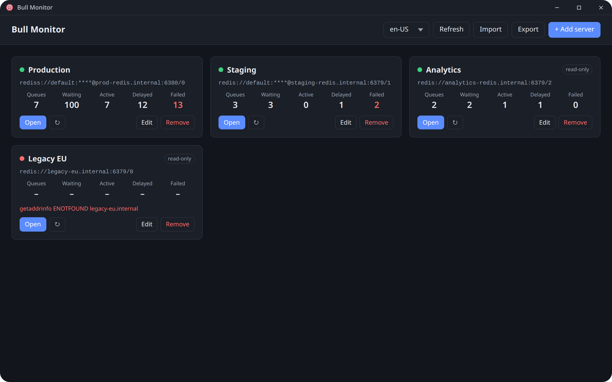
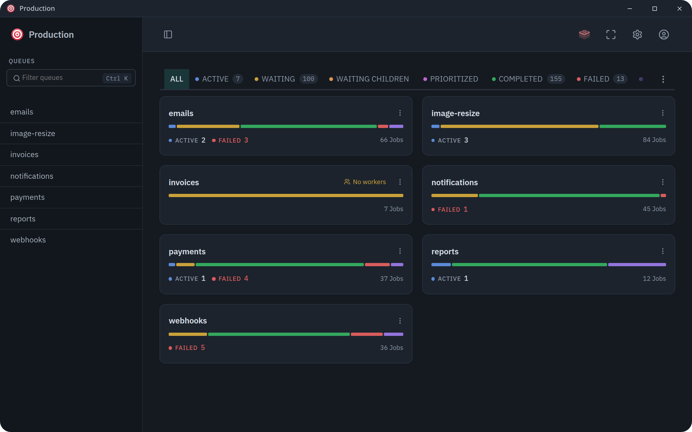
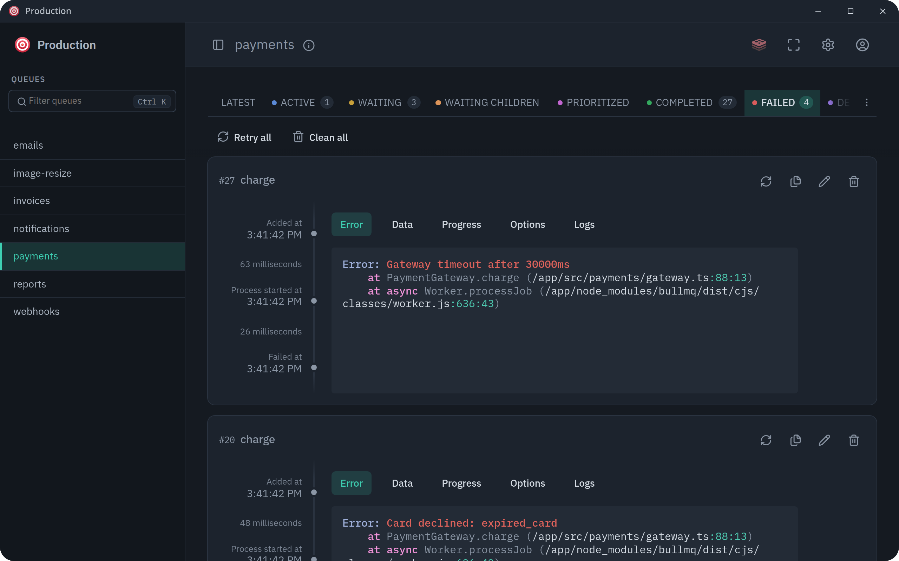
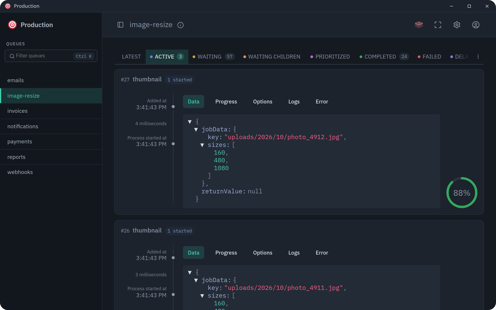
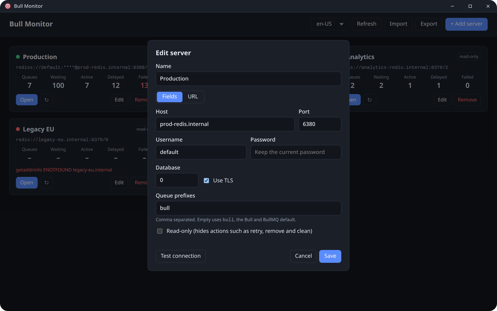

# Bull Monitor

App desktop para monitorar filas **Bull/BullMQ em vários servidores Redis**, usando a
interface original do [bull-board](https://github.com/felixmosh/bull-board).

> O Bull Monitor é um projeto independente e **não é afiliado** ao bull-board nem aos seus autores.
> Ele usa as bibliotecas publicadas do bull-board, sob a licença MIT.



- **Casco:** Tauri 2 (usa o webview do sistema, sem embutir o Chromium).
- **Backend:** um executável único em Bun (`sidecar/`) com uma board do bull-board por servidor.

```
Janela Tauri ──HTTP 127.0.0.1──▶ sidecar Bun ──▶ Redis A, Redis B, Redis C…
                                  /           tela de servidores
                                  /s/<id>/    bull-board do servidor <id>
```

## Telas

Os prints usam dados fictícios.

| Visão geral da board | Jobs com falha |
|---|---|
|  |  |
| **Jobs ativos com progresso** | **Cadastro de servidor** |
|  |  |

## Pré-requisitos (Zorin/Ubuntu)

```bash
# Bibliotecas do Tauri
sudo apt update
sudo apt install libwebkit2gtk-4.1-dev build-essential curl wget file \
  libxdo-dev libssl-dev libayatana-appindicator3-dev librsvg2-dev

# Rust
curl --proto '=https' --tlsv1.2 -sSf https://sh.rustup.rs | sh
source ~/.cargo/env
```

### Bun

O Bun roda e compila o sidecar. O build gera um executável único que já leva o Bun dentro, então
quem só usa o app instalado não precisa dele. É preciso a versão **1.2.3 ou mais nova**; o
projeto foi testado com a 1.4.2.

```bash
# O instalador baixa um .zip, por isso precisa do unzip
sudo apt install unzip

# Instala em ~/.bun e adiciona ao PATH no ~/.zshrc ou ~/.bashrc
curl -fsSL https://bun.sh/install | bash

# Recarrega o shell (ou abra um terminal novo) e confira
exec $SHELL
bun --version
```

Para atualizar depois: `bun upgrade`.

Em outros sistemas:

- **macOS:** `brew install oven-sh/bun/bun` ou o mesmo `curl` acima.
- **Windows (PowerShell):** `powershell -c "irm bun.sh/install.ps1 | iex"`.

### Dependências do projeto

```bash
bun install            # CLI do Tauri
cd sidecar && bun install
```

## Desenvolvimento

```bash
bun run dev            # compila o sidecar e abre o app Tauri
```

Só o sidecar, no navegador (não precisa de Rust):

```bash
bun run dev:sidecar    # imprime BULL_MONITOR_READY http://127.0.0.1:<porta>/?token=…
```

Abra a URL impressa. Para fixar a porta: `PORT=3000 bun run dev:sidecar`.

Para ter filas de exemplo num Redis de teste:

```bash
cd sidecar && bun scripts/seed.ts redis://localhost:6379
```

## Gerar o instalador

```bash
bun run build                       # .deb, .rpm e AppImage em src-tauri/target/release/bundle/
bun run tauri build --bundles deb   # só o .deb
```

O instalador precisa ser gerado em cada sistema (Linux, Windows, macOS). O GitHub Actions faz
isso para todos de uma vez; veja abaixo.

## Releases (GitHub Actions)

O workflow [`.github/workflows/release.yml`](.github/workflows/release.yml) gera os instaladores
em paralelo, cada um no sistema nativo:

| Plataforma | Arquivos |
|---|---|
| Linux x64 e ARM64 | `.deb`, `.rpm`, `.AppImage` |
| Windows x64 | `.msi` e `.exe` (NSIS) |
| macOS Apple Silicon e Intel | `.dmg` |

Para publicar uma versão:

1. Atualize a versão em `src-tauri/tauri.conf.json`, `src-tauri/Cargo.toml` e nos dois `package.json`.
2. Crie e envie a tag com o mesmo número: `git tag v0.4.0 && git push origin v0.4.0`.
3. O workflow publica a release com todos os instaladores, disponível para download na aba
   **Releases**. Ela só fica pública se os cinco builds passarem; se algum falhar, fica como
   rascunho (visível só para quem tem acesso ao repositório) e dá para rodar de novo os jobs que
   falharam na página do run.

Se a tag não bater com a versão do `tauri.conf.json`, o workflow para antes de compilar. Para
só testar o build, rode o workflow manualmente (aba Actions → Release → Run workflow); os
instaladores ficam como artefatos do run.

Os instaladores **não são assinados**. No Windows, o SmartScreen avisa na primeira execução
("Mais informações" → "Executar assim mesmo"). No macOS, o Gatekeeper bloqueia o app baixado; para
liberar, rode `xattr -dr com.apple.quarantine "/Applications/Bull Monitor.app"`.

## Como funciona

| Arquivo | O que faz |
|---|---|
| `sidecar/src/index.ts` | Servidor HTTP (Bun), API da tela inicial, token de acesso |
| `sidecar/src/boards.ts` | Conexões Redis, resumo por servidor, criação das boards |
| `sidecar/src/discovery.ts` | Descobre as filas Bull e BullMQ por `SCAN` (adaptado do CLI do bull-board) |
| `sidecar/src/config.ts` | Lê e grava `servers.json` e `settings.json` |
| `sidecar/src/i18n.ts` | Mensagens do servidor em cada idioma |
| `sidecar/public/` | Tela de servidores (HTML/CSS/JS puros) e textos dela em `i18n.js` |
| `sidecar/public/board.js` | Injetado nas boards: sincroniza o idioma e esconde o link de versão |
| `src-tauri/src/lib.rs` | Sobe o sidecar, espera a linha `BULL_MONITOR_READY` e aponta a janela para ela |
| `scripts/build-sidecar.sh` | Compila o sidecar e copia a interface do bull-board para os recursos |

- **Leveza:** a board de um servidor só é criada quando você abre esse servidor. A tela inicial
  atualiza a cada 15 s, e só enquanto está visível. A descoberta de filas fica em cache por 60 s.
- **Segurança:** o sidecar escuta só em `127.0.0.1`, recusa outros `Host` e exige um token
  aleatório gerado a cada execução, guardado num cookie `HttpOnly`.
- **Configuração:** fica em `~/.config/dev.renan.bullmonitor/servers.json` (permissão `600`). As
  senhas ficam nesse arquivo em texto puro e nunca são enviadas para a interface.
- **Idioma:** inglês por padrão. Pode ser trocado na tela inicial ou nas configurações da board;
  os dois seletores são o mesmo e a escolha fica em `settings.json`, na mesma pasta. São os 12
  idiomas do bull-board.
- **Voltar para a lista:** dentro de uma board, o link **← Servidores** fica no menu do ícone de
  usuário, no canto superior direito.

## Problemas conhecidos

- Tela branca no Linux com placa NVIDIA: rode com `WEBKIT_DISABLE_DMABUF_RENDERER=1`.
- Se o sidecar encerrar com erro, o app fecha. O motivo aparece no terminal.
- Redis Cluster e Sentinel ainda não são suportados, só `redis://` e `rediss://`.

## Licença

O código do Bull Monitor é distribuído sob a [licença MIT](LICENSE): qualquer pessoa pode usar,
copiar, modificar e distribuir, inclusive comercialmente, desde que mantenha o aviso de copyright e
a licença.

O app inclui software de terceiros, como a API e a interface do bull-board (MIT, Copyright (c) 2019
Vitor Capretz), as bibliotecas Bull, BullMQ e ioredis, o runtime do Bun e as crates do Tauri. As
licenças de todos eles estão em [THIRD_PARTY_NOTICES.md](THIRD_PARTY_NOTICES.md), que também vai
dentro do instalador.

Esse arquivo é gerado pelo build (`bun run build` roda `bun run build:notices`). Depois de mudar
dependências, regenere e faça commit:

```bash
bun run build:notices
```

